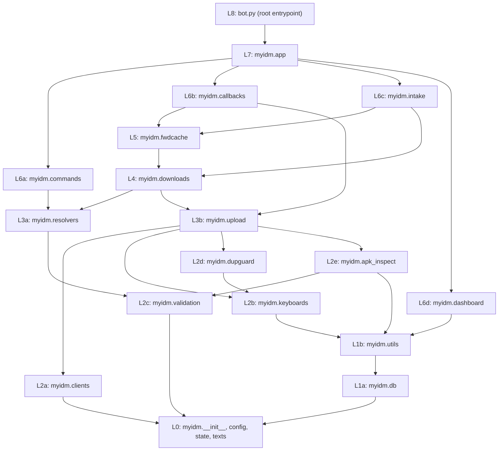

# MyIDM Bot Target Package Architecture

## 1. Package Layout and Line-Range Mapping

The 6,088-line monolith (`bot.py`) decomposes into a single Python package named `myidm/` (20 single-responsibility files) plus a thin root entrypoint `bot.py` (~30 lines) and existing fallback `main.py` (6 lines). Keeping `bot.py` as the root entrypoint alongside `myidm/` avoids module-vs-package name shadowing during incremental extraction, allows every intermediate phase to run via `python bot.py`, and keeps `Dockerfile`, `Procfile`, and `main.py` operational without breaking changes.

### 1.1 Module Specification Table (100% of `bot.py:1-6088` Accounted For)

| Layer | Target Module | Single Responsibility | Absorbed `bot.py` Lines | Public Surface Exposed |
| :---: | :--- | :--- | :--- | :--- |
| `L0a` | `myidm/__init__.py` | Python 3.12+ main-thread event-loop guard, Pyrogram 64-bit channel ID patch, `yt-dlp` Odnoklassniki `_parse_json` guard | `1-38`, `44-53`, `66-81` | `_safe_ok_parse_json`, `YTDLP_AVAILABLE` |
| `L0b` | `myidm/config.py` | Environment contract, logging setup (`"bot"` root logger), optional library flags, owner gate, directory paths, HTTP headers, TLS notice | `39-43`, `54-65`, `82-141`, `167-174`, `5075` | `logger`, `PSUTIL_AVAILABLE`, `CURL_CFFI_AVAILABLE`, `CurlAsyncSession`, `TORRENTP_AVAILABLE`, `TorrentDownloader`, `YTDLP_AVAILABLE`, `API_ID`, `API_HASH`, `BOT_TOKEN`, `PORT`, `ADMIN_IDS`, `ADMIN_ID`, `is_admin`, `_owner_filter`, `owner_filter`, `USER_SESSION_STRING`, `MAX_SINGLE_FILE_SIZE`, `SPLIT_PART_SIZE`, `DATA_DIR`, `DB_FILE`, `PENDING_DIR`, `DISK_MIN_FREE_GB`, `BASE_TMP`, `DOWNLOAD_DIR`, `START_TIME`, `STEALTH_HEADERS`, `TLS_VERIFICATION_SKIPPED_NOTICE` |
| `L0c` | `myidm/state.py` | Single home for in-memory active transfer registry and async request queue | `1025-1027` | `ACTIVE_TASKS`, `request_queue` |
| `L0d` | `myidm/texts.py` | Bilingual (`ar`/`en`) `TEXTS` dictionary (50 keys per language) and `tr()` lookup helper | `175-346`, `1018-1021` | `TEXTS`, `tr` |
| `L1a` | `myidm/db.py` | SQLite schema creation, WAL pragmas, guarded migrations, dashboard secret persistence, and all CRUD queries | `142-166`, `347-1017`, `1022-1024` | `ALLOWED_USER_SETTINGS`, `DASHBOARD_SECRET`, `get_or_create_dashboard_secret`, `init_db`, `db_add_user`, `db_get_user_settings`, `db_add_replacement`, `db_get_user_replacements`, `db_clear_user_replacements`, `db_get_total_users_count`, `db_update_user_setting`, `db_add_history`, `db_get_history`, `db_add_apk_inspection`, `db_get_last_inspection_for_package`, `db_check_apk_duplicate`, `db_add_pending_download`, `db_get_pending_download`, `db_update_pending_status`, `db_record_delivery`, `db_get_delivery`, `db_get_delivery_by_id`, `db_delete_delivery`, `db_get_apk_inspection`, `cleanup_expired_pending_downloads`, `db_get_all_user_ids`, `db_get_global_stats` |
| `L1b` | `myidm/utils.py` | Byte/time/Cairo formatters, file category classifier, filename sanitizer/renamer, Content-Disposition parser, chat ID parser, disk space guards | `1889-2125`, `2710-2716` | `humanbytes`, `time_formatter`, `format_cairo_time`, `get_god_category`, `sanitize_filename`, `clean_and_rename_filename`, `smart_extract_filename`, `parse_chat_id`, `check_disk_space`, `check_disk_space_for_split` |
| `L2a` | `myidm/clients.py` | Construction of Pyrogram `bot` (`downloader_bot`), dormant `user_bot`, and uploader client selector | `1391-1418` | `bot`, `user_bot`, `get_uploader_client` |
| `L2b` | `myidm/keyboards.py` | Inline keyboard builders, throttled transfer progress bar, and `MessageNotModified`-safe editor | `2126-2255`, `3077-3086` | `make_start_keyboard`, `make_settings_keyboard`, `make_brand_keyboard`, `make_back_keyboard`, `make_cancel_keyboard`, `make_duplicate_keyboard`, `progress_bar`, `safe_edit_text` |
| `L2c` | `myidm/validation.py` | Binary magic-byte / HTML page validator, HTML video/file link extractors, and TLS cert-error classifier | `1419-1597`, `5076-5133` | `is_valid_binary_file`, `extract_video_embed_from_html`, `extract_real_download_link_from_html`, `is_cert_verification_error` |
| `L2d` | `myidm/dupguard.py` | Duplicate APK warning card formatter (`package AND version_code` presentation) | `3028-3076` | `format_duplicate_warning_card`, `make_duplicate_keyboard` (re-export from `keyboards`) |
| `L2e` | `myidm/apk_inspect.py` | Streaming SHA-256, binary AXML parser, v1/v2/v3 X.509 cert extractor, APK/XAPK/APKS inspector, signer warning, frozen `BLITZVERIFY v1` formatter, post-upload inspection hook | `2256-2709`, `2717-2990`, `3087-3140` | `compute_file_sha256`, `format_dn`, `parse_axml`, `extract_v1_cert`, `extract_v2_v3_cert`, `inspect_apk`, `format_apk_inspection_card`, `format_signer_change_warning`, `format_blitzverify_block`, `handle_apk_inspection_card` |
| `L3a` | `myidm/resolvers.py` | Host-specific direct link resolvers (TeraBox, 1Fichier, Mega, Mediafire, Pixeldrain, AN1, GitHub, Dropbox, Google Drive, DocumentaryArea, OK.ru, Catbox, generic HTML) | `1598-1888`, `4714-4776` | `unrestrict_terabox`, `unrestrict_1fichier`, `unrestrict_mega`, `unrestrict_direct_link`, `get_ok_direct_mp4` |
| `L3b` | `myidm/upload.py` | `ffprobe`/`ffmpeg` metadata & thumbnail extractor, file caption builder, resilient media sender, local file upload pipeline, and approved duplicate uploader | `3141-3199`, `4136-4425`, `4936-5074` | `extract_video_metadata`, `build_file_caption`, `resilient_send_media`, `process_single_local_file_upload`, `run_approved_pending_upload` |
| `L4` | `myidm/downloads.py` | Multi-stream turbo engine, HLS/`yt-dlp` stream engine, torrent engine, ZIP bundle engine, and main HTTP download-and-upload orchestrator | `4067-4135`, `4426-4713`, `4777-4935`, `5134-5988` | `is_speed_throttled_url`, `download_multi_stream_turbo`, `is_hls_or_video_stream`, `download_video_or_m3u8`, `process_torrent_download`, `process_zip_bundle`, `process_download_and_upload` |
| `L5` | `myidm/fwdcache.py` | URL-keyed Telegram message forward cache, stale-message fallback, and fresh re-download trigger | `2991-3027`, `3574-3666` | `format_fwdcache_note`, `is_message_not_found_error`, `handle_url_intake`, `run_fresh_download` |
| `L6a` | `myidm/commands.py` | All 17 owner/admin `/` command handlers (`30` command names) | `3200-3573` | `start_handler` .. `clear_brand_handler`, `register_command_handlers` |
| `L6b` | `myidm/callbacks.py` | Inline `CallbackQuery` router (`callback_handler`) | `3667-3944` | `callback_handler`, `register_callback_handlers` |
| `L6c` | `myidm/intake.py` | `.torrent` document handler, text/magnet/`[ZIP]`/URL intake handler, and `request_queue` worker | `3945-4066` | `handle_document_torrent`, `handle_all_messages`, `handle_queued_task`, `queue_worker`, `register_intake_handlers` |
| `L6d` | `myidm/dashboard.py` | `aiohttp` health check, authenticated live HTML dashboard, JSON telemetry API, and task cancel API | `1028-1390` | `DASHBOARD_HTML_TEMPLATE`, `handle_health_check`, `handle_dashboard_view`, `handle_dashboard_stats_api`, `handle_dashboard_cancel_task_api`, `start_web_server` |
| `L7` | `myidm/app.py` | Temp directory cleaner, hourly background cleaner worker, deterministic handler wiring, `BotCommand` menu setup, and `main()`/`run()` lifecycle | `5989-6088` | `BOT_COMMANDS`, `cleanup_temp_dir`, `background_cleaner_worker`, `register_all_handlers`, `main`, `run` |
| `L8` | `bot.py` (root) | Container/CLI entrypoint delegating to `myidm.app.run()` | Thin entrypoint | `__main__` execution (plus transitional re-exports until Phase 6) |

---

## 2. Acyclic Import Graph, Handle Placement, and State Housing

### 2.1 Strict Layered DAG Rules

Every module is assigned a strict topological rank (`L0a < L0b < L0c < L0d < L1a < L1b < L2a < L2b < L2c < L2d < L2e < L3a < L3b < L4 < L5 < L6a < L6b < L6c < L6d < L7 < L8`).

1. **Downward-Only Rule**: Module `X` may import module `Y` **if and only if `rank(X) > rank(Y)`**. Same-rank or upward imports are forbidden, making circular imports mathematically impossible.
2. **Module-Namespace Access Rule (Anti-Stale-Binding Rule)**:
   - No module in `myidm/` may use `from myidm.config import DB_FILE, DATA_DIR, PENDING_DIR, DOWNLOAD_DIR, DISK_MIN_FREE_GB, CURL_CFFI_AVAILABLE, CurlAsyncSession` or copy mock-patched functions via `from myidm.upload import resilient_send_media`.
   - Instead, modules import the module namespace (`from myidm import config as cfg, state, db, resolvers, upload, apk_inspect, validation`) and dereference attributes at call time (`cfg.DB_FILE`, `cfg.CURL_CFFI_AVAILABLE`, `upload.resilient_send_media(...)`, `resolvers.unrestrict_direct_link(...)`).
   - This guarantees that test mutations (`cfg.DB_FILE = ...`) and `unittest.mock.patch("myidm.upload.resilient_send_media", ...)` take effect across every caller without stale local bindings.
3. **Logger Hierarchy Rule**:
   - `myidm/config.py` configures `logger = logging.getLogger("bot")`, and submodules use `logging.getLogger("bot.<module>")` (or `cfg.logger`).
   - Because `"bot.<module>"` is a child of `"bot"` in Python's standard `logging` tree, all log records propagate to `"bot"`, keeping `self.assertLogs("bot", level="WARNING")` in `tests/test_fwdcache.py` and `tests/test_sslretry.py` working by construction.



### 2.2 Explicit Home for Every State Object and Handle

Zero new globals are introduced. Every stateful object from Inventory Section 5 has exactly one canonical home:

| State Object / Handle | Canonical Home | Access Pattern | Lifecycle Notes |
| :--- | :--- | :--- | :--- |
| `bot`, `user_bot` | `myidm/clients.py` | `clients.bot`, `clients.user_bot`, `clients.get_uploader_client()` | `Client("downloader_bot", workdir=cfg.DATA_DIR, workers=16)` unchanged. |
| SQLite connections & `DASHBOARD_SECRET` | `myidm/db.py` | `sqlite3.connect(cfg.DB_FILE, timeout=30)` inside `db.py` only; `db.DASHBOARD_SECRET` | Zero direct `sqlite3.connect` calls outside `myidm/db.py`; `init_db()` runs before `get_or_create_dashboard_secret()` so WAL mode is active from the first query. |
| `ACTIVE_TASKS`, `request_queue` | `myidm/state.py` | `state.ACTIVE_TASKS`, `state.request_queue` | Mutated only through `state.ACTIVE_TASKS[...]` and `state.request_queue`. |
| `DATA_DIR`, `DB_FILE`, `PENDING_DIR`, `DOWNLOAD_DIR`, `DISK_MIN_FREE_GB` | `myidm/config.py` | `cfg.DATA_DIR`, `cfg.DB_FILE`, `cfg.PENDING_DIR`, `cfg.DOWNLOAD_DIR`, `cfg.DISK_MIN_FREE_GB` | Read dynamically at call time so test directory isolation works cleanly. |
| `ADMIN_IDS`, `START_TIME`, `CURL_CFFI_AVAILABLE`, `PSUTIL_AVAILABLE`, `TORRENTP_AVAILABLE`, `YTDLP_AVAILABLE` | `myidm/config.py` | `cfg.ADMIN_IDS`, `cfg.START_TIME`, `cfg.CURL_CFFI_AVAILABLE`, etc. | Feature flags stay patchable at `myidm.config.<FLAG>`. |
| `TEXTS` | `myidm/texts.py` | `texts.TEXTS`, `texts.tr(...)` | Read-only localization dictionary. |

---

## 3. Preservation of Frozen External Contracts (Section B) by Construction

1. **Contract B.1 (`BLITZVERIFY v1` Block)**:
   - `format_blitzverify_block` moves verbatim into `myidm/apk_inspect.py` with zero edits to field order (`package`, `version_name`, `version_code`, `size_bytes`, `min_sdk`, `target_sdk`, `file_sha256`, `cert_sha256`, `inspected_at`), omit rules, lowercase SHA normalization, `Africa/Cairo` formatting, or ```` ```\n...\n``` ```` Markdown fencing.
   - Its two emit sites (`apk_inspect.handle_apk_inspection_card` after upload and `fwdcache.handle_url_intake` on cached APK forward, including `min_sdk`/`target_sdk`) remain the sole emit points.
   - `tests/test_contract_parity.py` verifies exact byte-for-byte SHA-256 equality of `format_blitzverify_block` outputs across full, partial, bundle, and degraded fixtures.
2. **Contract B.2 (`callback_data` Values & Button Labels)**:
   - `myidm/keyboards.py` and `myidm/callbacks.py` expose explicit frozen-tuple constants `EMITTED_CALLBACK_EXACT` (18), `EMITTED_CALLBACK_PREFIXES` (4), and `HANDLED_CALLBACK_PATTERNS` (23, preserving `btn_help`), verified by AST extraction against the Phase 0 register on every phase run. All button label strings move byte-for-byte unchanged.
3. **Contract B.3 (Bot Command Names & Deterministic Handler Order)**:
   - `myidm/commands.py` registers the exact 17 command handlers covering all 30 command strings; `myidm/app.py` registers the exact 12 `BotCommand` menu items (`BOT_COMMANDS`).
   - Instead of relying on accidental import order for decorator side effects, `myidm/app.py:register_all_handlers(bot)` (idempotent, guarded by a `_handlers_registered` flag on `clients`) registers handlers in the exact frozen sequence:
     1. `commands.register_command_handlers(bot)` (17 command handlers)
     2. `callbacks.register_callback_handlers(bot)` (1 callback query handler)
     3. `intake.register_intake_handlers(bot)` (`handle_document_torrent`, then `handle_all_messages` last).
   - `register_all_handlers(clients.bot)` is called once when `myidm.app` (or `bot.py`) loads, so `handle_all_messages` can never precede command handlers.
4. **Contract B.4 (`TEXTS` Localization Keys & Bytes)**:
   - `myidm/texts.py` holds all 50 `ar` keys and 50 `en` keys with identical UTF-8 bytes (including the 11 currently unreferenced keys). `test_contract_parity.py` asserts exact key-set equality and exact SHA-256 digest of `json.dumps(TEXTS, ensure_ascii=False, sort_keys=True)`.
5. **Contract B.5 (SQLite Production Compatibility)**:
   - `myidm/db.py:init_db()` executes the exact `CREATE TABLE IF NOT EXISTS` statements for all 8 tables (`users`, `history`, `global_stats`, `custom_replacements`, `apk_inspections`, `download_deliveries`, `bot_meta`, `pending_downloads`), `CREATE INDEX IF NOT EXISTS idx_deliveries_user_url`, and all 12 guarded `ALTER TABLE` statements, opening `os.path.join(DATA_DIR, "bot_database.db")` in `WAL` mode with `busy_timeout=30000`.
   - `test_contract_parity.py` creates a fresh database and a simulated pre-migration database, runs `init_db()`, and asserts `PRAGMA table_info(...)` and index definitions match the Phase 0 census schema column-for-column.
6. **Contract B.6 (Duplicate & `fwdcache` Semantics)**:
   - `db_check_apk_duplicate(package, version_code)` (`package = ? AND version_code = ?`), `pending_downloads` staging in `PENDING_DIR`, 24-hour expiry of `('pending', 'approved')` rows in `cleanup_expired_pending_downloads()`, fragment-preserving `url_key = (url or "").strip()`, and fallback strictly on `is_message_not_found_error` move unchanged into `db.py`, `upload.py`, `downloads.py`, and `fwdcache.py`.
7. **Contract B.7 (TLS Retry Semantics)**:
   - `validation.is_cert_verification_error` and the single unverified retry blocks in `downloads.process_download_and_upload` move unchanged, logging one warning on `"bot.downloads"` (propagating to `"bot"`) and appending `cfg.TLS_VERIFICATION_SKIPPED_NOTICE` to the success card.
8. **Contract B.8 (Identity, Session & Owner Gate)**:
   - `clients.bot` keeps `name="downloader_bot"`, `workdir=cfg.DATA_DIR`, `workers=16`, reading `downloader_bot.session` from `DATA_DIR` without re-authentication. `cfg.ADMIN_IDS` keeps `{1594244556, 7639267441}` unioned with parsed `ADMIN_ID` digits.
9. **Contract B.9 (Environment Contract & Secret Hygiene)**:
   - All 11 environment variable reads (`API_ID`, `API_HASH`, `BOT_TOKEN`, `PORT`, `DATA_DIR`, `DISK_MIN_FREE_GB`, `ADMIN_ID`, `DASHBOARD_SECRET`, dormant `CHANNEL_ID`, dormant `USER_SESSION_STRING` / `PREMIUM_SESSION`) keep their exact names, defaults, and parsing rules.

---

## 4. Mechanical Test Re-Pointing Map (Test by Test)

During Phases 1 through 5, root `bot.py` re-exports moved symbols so un-migrated tests stay green while newly extracted modules are tested directly. In each phase (completed in Phase 6), the 11 test files in `tests/` re-point mechanically to their canonical `myidm.*` modules with **zero weakened assertions**:

1. **`tests/test_apkinspect_regression.py`** (7 tests):
   - `bot.inspect_apk` -> `myidm.apk_inspect.inspect_apk`
   - `bot.format_apk_inspection_card` -> `myidm.apk_inspect.format_apk_inspection_card`
   - `bot.handle_apk_inspection_card` -> `myidm.apk_inspect.handle_apk_inspection_card`
   - `bot.db_add_apk_inspection` -> `myidm.db.db_add_apk_inspection`
   - `bot.db_get_last_inspection_for_package` -> `myidm.db.db_get_last_inspection_for_package`
   - `bot.ParseMode` -> `pyrogram.enums.ParseMode`; `bot.time` -> `time`
2. **`tests/test_apkinspect_suite.py`** (standalone verification script):
   - `from bot import inspect_apk, format_dn, compute_file_sha256` -> `from myidm.apk_inspect import inspect_apk, format_dn, compute_file_sha256`
3. **`tests/test_blitzverify.py`** (6 tests):
   - `bot.format_blitzverify_block` -> `myidm.apk_inspect.format_blitzverify_block`
   - `bot.handle_apk_inspection_card` -> `myidm.apk_inspect.handle_apk_inspection_card`
4. **`tests/test_dashoff.py`** (3 tests):
   - `bot.make_start_keyboard` -> `myidm.keyboards.make_start_keyboard`
   - Source inspection in `test_admin_panel_callback_keyboard`: scans `bot.py` and all `myidm/*.py` files to assert absence of `btn_get_dashboard`, `dashboard_command`, and `BotCommand("dashboard"`, and reads `myidm/callbacks.py` to verify `admin_kbd`.
   - Source inspection in `test_web_server_routes_preserved`: reads `myidm/dashboard.py` and `myidm/db.py` to assert presence of `handle_dashboard_view`, `handle_dashboard_stats_api`, `handle_dashboard_cancel_task_api`, `/dashboard` and `/api/dashboard/stats` routes, and `get_or_create_dashboard_secret`.
5. **`tests/test_dedupguard.py`** (13 tests):
   - Path/config overrides: `bot.DATA_DIR`, `bot.DB_FILE`, `bot.PENDING_DIR`, `bot.DOWNLOAD_DIR`, `bot.DISK_MIN_FREE_GB` -> `myidm.config.*`
   - Clients: `bot.bot`, `bot.user_bot` -> `myidm.clients.bot`, `myidm.clients.user_bot`
   - DB helpers: `bot.init_db`, `bot.get_or_create_dashboard_secret`, `bot.db_add_apk_inspection`, `bot.db_get_last_inspection_for_package`, `bot.db_check_apk_duplicate`, `bot.db_add_pending_download`, `bot.db_get_pending_download`, `bot.db_update_pending_status`, `bot.cleanup_expired_pending_downloads` -> `myidm.db.*`
   - Disk & cleanup: `bot.check_disk_space`, `bot.check_disk_space_for_split` -> `myidm.utils.*`; `bot.cleanup_temp_dir` -> `myidm.app.cleanup_temp_dir`
   - Formatters & keyboards: `bot.format_apk_inspection_card` -> `myidm.apk_inspect.format_apk_inspection_card`; `bot.format_duplicate_warning_card` -> `myidm.dupguard.format_duplicate_warning_card`; `bot.make_duplicate_keyboard` -> `myidm.keyboards.make_duplicate_keyboard`
   - `test_task3_zero_eval_in_bot`: extended to scan `bot.py`, `main.py`, and every `myidm/**/*.py` file for `"eval("` and `"/eval"`.
6. **`tests/test_dupfix.py`** (2 tests):
   - Path overrides: `bot.DATA_DIR`, `bot.DB_FILE`, `bot.PENDING_DIR` -> `myidm.config.*`
   - DB helpers: `bot.init_db`, `bot.db_add_pending_download`, `bot.db_get_pending_download`, `bot.cleanup_expired_pending_downloads` -> `myidm.db.*`
   - Upload runner: `bot.run_approved_pending_upload` -> `myidm.upload.run_approved_pending_upload`
   - Patches: `patch("bot.resilient_send_media", ...)` -> `patch("myidm.upload.resilient_send_media", ...)`; `patch("bot.handle_apk_inspection_card", ...)` -> `patch("myidm.apk_inspect.handle_apk_inspection_card", ...)`
7. **`tests/test_end_to_end_simulation.py`** (4 E2E flows):
   - `bot.DB_FILE` -> `myidm.config.DB_FILE`
   - `bot.process_download_and_upload` -> `myidm.downloads.process_download_and_upload`
   - `bot.run_approved_pending_upload` -> `myidm.upload.run_approved_pending_upload`
   - Patch: `patch("bot.resilient_send_media", ...)` -> `patch("myidm.upload.resilient_send_media", ...)`
8. **`tests/test_fwdcache.py`** (13 tests):
   - Path overrides: `bot.DATA_DIR`, `bot.DB_FILE`, `bot.DOWNLOAD_DIR`, `bot.PENDING_DIR` -> `myidm.config.*`
   - DB helpers: `bot.init_db`, `bot.db_add_apk_inspection`, `bot.db_check_apk_duplicate`, `bot.db_get_apk_inspection`, `bot.db_record_delivery`, `bot.db_get_delivery`, `bot.db_get_delivery_by_id` -> `myidm.db.*`
   - Functions: `bot.handle_url_intake` -> `myidm.fwdcache.handle_url_intake`; `bot.callback_handler` -> `myidm.callbacks.callback_handler`; `bot.process_download_and_upload` -> `myidm.downloads.process_download_and_upload`; `bot.format_blitzverify_block` -> `myidm.apk_inspect.format_blitzverify_block`
   - Patches:
     - `patch.object(bot.bot, "forward_messages", ...)` -> `patch.object(myidm.clients.bot, "forward_messages", ...)`
     - `patch("bot.process_download_and_upload", ...)` -> `patch("myidm.downloads.process_download_and_upload", ...)`
     - `patch("bot.is_admin", ...)` -> `patch("myidm.config.is_admin", ...)`
     - `patch("bot.unrestrict_direct_link", ...)` -> `patch("myidm.resolvers.unrestrict_direct_link", ...)`
     - `patch("bot.is_hls_or_video_stream", ...)` -> `patch("myidm.downloads.is_hls_or_video_stream", ...)`
     - `patch("bot.download_video_or_m3u8", ...)` -> `patch("myidm.downloads.download_video_or_m3u8", ...)`
     - `patch("bot.is_valid_binary_file", ...)` -> `patch("myidm.validation.is_valid_binary_file", ...)`
     - `patch("bot.inspect_apk", ...)` -> `patch("myidm.apk_inspect.inspect_apk", ...)`
     - `patch("bot.db_check_apk_duplicate", ...)` -> `patch("myidm.db.db_check_apk_duplicate", ...)`
     - `patch("bot.resilient_send_media", ...)` -> `patch("myidm.upload.resilient_send_media", ...)`
     - `patch("bot.handle_apk_inspection_card", ...)` -> `patch("myidm.apk_inspect.handle_apk_inspection_card", ...)`
   - `self.assertLogs("bot", level="WARNING")`: unchanged (`"bot.fwdcache"` propagates to `"bot"`).
9. **`tests/test_nocard.py`** (6 tests):
   - `bot.format_signer_change_warning`, `bot.handle_apk_inspection_card` -> `myidm.apk_inspect.*`
   - `bot.db_add_apk_inspection`, `bot.db_check_apk_duplicate`, `bot.db_add_pending_download` -> `myidm.db.*`
   - `bot.run_approved_pending_upload` -> `myidm.upload.run_approved_pending_upload`
   - Patch: `patch("bot.resilient_send_media", ...)` -> `patch("myidm.upload.resilient_send_media", ...)`
10. **`tests/test_real_apk_inspection.py`** (standalone large-APK test):
    - `bot.inspect_apk`, `bot.extract_v2_v3_cert`, `bot.format_apk_inspection_card` -> `myidm.apk_inspect.*`; `bot.hashes` -> `cryptography.hazmat.primitives.hashes`
11. **`tests/test_sslretry.py`** (6 tests):
    - Path overrides: `bot.DATA_DIR`, `bot.DB_FILE`, `bot.DOWNLOAD_DIR`, `bot.PENDING_DIR` -> `myidm.config.*`
    - `bot.init_db` -> `myidm.db.init_db`
    - `bot.TLS_VERIFICATION_SKIPPED_NOTICE`, `bot.CURL_CFFI_AVAILABLE` -> `myidm.config.*`
    - `bot.is_cert_verification_error` -> `myidm.validation.is_cert_verification_error`
    - `bot.process_download_and_upload` -> `myidm.downloads.process_download_and_upload`
    - Patches:
      - `patch("bot.CURL_CFFI_AVAILABLE", ...)` -> `patch("myidm.config.CURL_CFFI_AVAILABLE", ...)`
      - `patch("bot.CurlAsyncSession", ...)` -> `patch("myidm.config.CurlAsyncSession", ...)`
      - `patch("bot.unrestrict_direct_link", ...)` -> `patch("myidm.resolvers.unrestrict_direct_link", ...)`
      - `patch("bot.resilient_send_media", ...)` -> `patch("myidm.upload.resilient_send_media", ...)`
      - `patch("aiohttp.TCPConnector", ...)`: unchanged.
    - `self.assertLogs("bot", level="WARNING")`: unchanged (`"bot.downloads"` propagates to `"bot"`).

---

## 5. Entrypoint and Docker Build Adaptation

1. **`Dockerfile` (`Dockerfile:1-22`)**:
   - `WORKDIR /app`, `COPY requirements.txt .`, `RUN pip install --no-cache-dir -r requirements.txt`, `COPY . .`, and `CMD ["python", "bot.py"]` require **zero command changes**: `COPY . .` copies `/app/bot.py`, `/app/main.py`, and `/app/myidm/*.py` into `/app`, and `CMD ["python", "bot.py"]` launches `bot.py` with `/app` on `sys.path[0]`.
   - Any addition of a `.dockerignore` file is listed as Open Question `OQ-2` in the blueprint and will not be added unless approved by the owner.
2. **`Procfile` and `main.py`**:
   - `Procfile` (`web: python bot.py`) and `main.py` (`os.execv(sys.executable, [sys.executable, "bot.py"])`) remain untouched and valid.
3. **`DATA_DIR`, Session File, and Environment Contract**:
   - On EC2, the container mounts the host persistent directory at `DATA_DIR`. `myidm/config.py` reads `DATA_DIR = os.environ.get("DATA_DIR", ".")`, `DB_FILE = os.path.join(DATA_DIR, "bot_database.db")`, and `PENDING_DIR = os.path.join(DATA_DIR, "pending_downloads")`.
   - `myidm/clients.py` initializes `Client("downloader_bot", ..., workdir=cfg.DATA_DIR, workers=16)`, which resolves `os.path.join(DATA_DIR, "downloader_bot.session")` identically to the monolith. Neither the session file nor `bot_database.db` moves or changes format.

---

## 6. Parity Verification Strategy (Binding Per-Phase Battery)

Every execution phase must run and pass the following ordered verification battery locally with `DATA_DIR` pointed at an isolated temporary test directory (never touching local `bot_database.db` or `*.session`):

1. **Bytecode Compilation**:
   - `python -m py_compile bot.py main.py myidm/*.py tests/*.py` (zero syntax or indentation errors).
2. **Static Architecture & Hygiene Gate** (verified via `tests/test_contract_parity.py`):
   - Import-graph AST check proving `myidm/*` is a strict DAG respecting layer ranks `L0`..`L7` with zero circular imports and zero `myidm -> bot` reverse imports.
   - Zero `from myidm.config import DB_FILE` (or other mutable config copies) across `myidm/*.py`.
   - Zero `eval(` or `"/eval"` across `bot.py`, `main.py`, and `myidm/*.py`.
   - Zero banned dash characters (`\u2013`, `\u2014`) in any newly created or edited file (`myidm/*.py`, `docs/*.md`, `tests/*.py`), except the preserved legacy dead-code/regex lines moved verbatim from `bot.py:1490, 2868, 2870` unless owner approves editing them.
3. **Unit & Regression Test Suite**:
   - `DATA_DIR=<isolated_tmp> python -m unittest discover tests -v` passing at `>= 56` tests (growing as `test_contract_parity.py` and per-phase flow tests are added), `0` failures, `0` errors.
4. **End-to-End HTTP Simulation**:
   - `DATA_DIR=<isolated_tmp> python tests/test_end_to_end_simulation.py` passing all 4 live local-HTTP flows (`rc == 0`).
5. **Frozen Contract Parity Suite (`tests/test_contract_parity.py`)**:
   - **`BLITZVERIFY v1` byte parity**: exact byte-for-byte match against frozen golden outputs for full APK, partial SDK/cert, XAPK bundle, degraded placeholders, and empty input.
   - **`callback_data` parity**: exact equality against the 22 button-emitted callbacks (`18` exact + `4` prefixes) and 23 handled callback patterns.
   - **Command & handler-order parity**: exact equality against the 30 command names across 17 handlers, the 12 `BotCommand` entries, and verification that all 17 command handlers precede `handle_document_torrent` and `handle_all_messages` in `bot.dispatcher.groups[0]`.
   - **`TEXTS` byte parity**: exact key-set equality (`50` `ar`, `50` `en`) and exact SHA-256 digest of all `ar` and `en` string values against Phase 0 hashes.
   - **Database schema parity**: runs `init_db()` on both an empty SQLite file and a pre-migration legacy SQLite file, asserting exact table set (8 tables), column `(cid, name, type, notnull, dflt_value, pk)` tuples, and index `idx_deliveries_user_url` against the Phase 0 schema snapshot.
